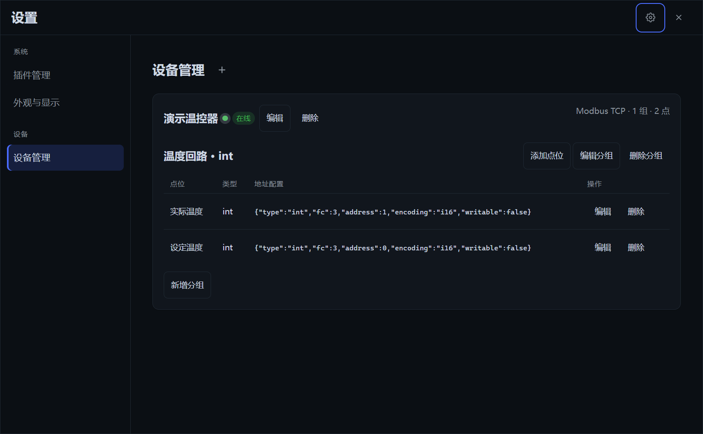
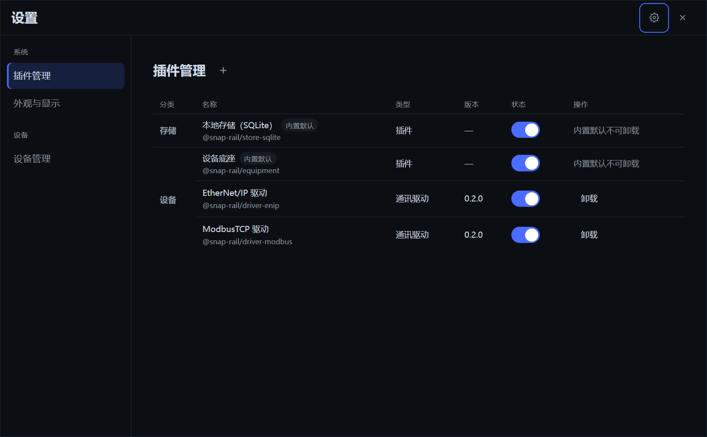

<div align="center">

# snap-rail

**工业终端的开源底座 —— 一个内核，形态由插件决定**

[](https://github.com/yansijian/snap-rail/releases)
[](https://www.snap-rail.top)
[](#license)
[](https://github.com/topics/snap-rail-plugin)

把 OT 现场数据与 IT 工具链装进一个「一切皆插件」的 Electron 宿主，基于 vendored
Cordis 元框架。底座只提供进程模型、数据缝与最小 UI 骨架，不复现组态画布与传统
HMI——界面创新留给社区与 Agent。

</div>

## 界面一览

| 开箱引导页 | 设备管理 |
| --- | --- |
|  |  |

## ✨ 特点

- **一个内核，形态由插件决定** —— 底座只给进程模型、数据缝与最小 UI；HMI
  面板、SCADA 工作站、边缘控制器等形态由套件插件定义，同一个内核各归各的工位。
- **六层分层架构** —— `base → store → equipment → ui → tool → suite`，依赖
  方向由门禁从包清单自动派生，没有手写名单；能力缝三件套（Definition /
  Provider / Consumer）齐备。
- **出厂底座开箱即用** —— 内置 SQLite 存储、设备底座、设备管理页、出厂双主题；
  驱动、业务页、套件、额外主题 zip 即装即用，装完立即可用（截图即内置设备管理页：
  驱动启用、设备在线、点表即配）。
- **插件 zip 三式安装、装前预检** —— 插件源搜索 / http(s) 直链 / 本地 zip 三种
  入口，安装前预检来源、签名、版本与依赖，`@snap-rail/*` 命名空间强制受信签名：

  

- **数据留在本机** —— 每命名空间一个 SQLite 库文件（默认 `%APPDATA%\snap-rail`），
  drizzle 查询构建器即规范；简单配置走 settings.json，都不依赖云端。
- **主题热切 + 悬浮球** —— token 级主题全窗口即时切换（无重载）；128px 悬浮球
  与主窗共存显隐、四边贴边停泊、指针离开自动收起。
- **多源插件源 & 去中心化发布** —— 插件源是静态 feed 列表（OSS / Gitea / GitHub
  任意加）；插件作者自持 Ed25519 密钥、发自己的滚动 Release，仓库打上 GitHub
  topic [`snap-rail-plugin`](https://github.com/topics/snap-rail-plugin) 即可被发现——
  没有集中市场、没有 PR 上架。
- **安全模式兜底** —— UI 基座不可用时 kernel 引导页就是恢复控制台（拖 zip 安装
  仍然可用）；`--safe-mode` / `Ctrl+Shift+F12` 位于一切 UI 契约之外，不可被覆盖。

## 📦 安装与启动

### 方式一：下载安装包（推荐）

从[官网](https://www.snap-rail.top)或
[GitHub Releases](https://github.com/yansijian/snap-rail/releases) 下载
`snap-rail-x.y.z-x64-setup.exe`，双击安装、启动即用。内置插件源已配好出厂
feed，打开「设置 → 插件管理」即可搜索安装驱动与套件；「设置 → 设备管理」
新增设备、配点表，驱动方言表单按驱动 schema 自动生成。

### 方式二：从源码运行

```sh
git clone https://github.com/yansijian/snap-rail.git
cd snap-rail
node scripts/setup-external.mjs   # 首次：把驱动拆分仓拉到 external/ 作 workspace 链接
pnpm install
pnpm app:dev                      # Vite dev server + Electron 实机开发，热重载
```

打包发行：`pnpm app:pack`（目录形态）/ `pnpm app:dist`（NSIS 安装包）。
离线/内网机器的打包方式见 [docs/deploy.md](docs/deploy.md)。

## 🤖 为 AI 助手安装开发技能

插件开发的完整知识——9 种模板（driver / store-provider / host-service /
tool / suite / ui-view / ui-layout / ui-extension / ui-skin）从脚手架到构建、
验证、签名、发布的全流程——已封装成 AI 可读的技能包，一条命令装进你的
AI 编程助手（ZCode / Claude Code 等）：

```sh
npx skills add yansijian/snap-rail --skill snap-rail-plugin-dev
```

装好后在一个独立插件仓库里让 AI 助手直接开工（不需要 snap-rail 源码）：

```sh
pnpm dlx @snap-rail/plugin-sdk init my-driver --template driver
```

技能本身只依赖公共 npm 的 `@snap-rail/plugin-sdk` 与 `snap-rail-plugin`
CLI；插件仓库根部按指南维护自己的 `AGENTS.md` 即可人机共用。

## 面向开发者

### 一分钟看懂

- **主进程**跑 Cordis 宿主树：内置层清单（只读，随包只带 base）+ 用户层
  userData `plugins.yml`（页面按钮、手编、Agent 共用一条热重载路径）合成
  实际挂载的插件集，watch 热重载、坏配置保持旧树并报错。
- **点表缝 `ctx.points`**：驱动连接注册点位、推送样本（`null`=异常）、路由
  写入；[`snap-rail-driver-modbus`](https://github.com/yansijian/snap-rail-driver-modbus)
  是纯协议适配器的范本（zod 方言 schema + 探测 + `createConnection`）。
- **renderer 是投影客户端**：preload 只暴露 `invoke`/`openStream`/`zipPathOf`
  三原语；内置 `@snap-rail/ui` runtime 接管 React root，布局、标题栏、看板、
  管理页都是插件贡献，没有业务套件时内置回退布局兜底。

### 仓库布局

```
vendor/      vendored Cordis（rescope @snap-rail/*，见 vendor/README.md）
packages/    层组 packages/<层>/<包>（snapRail.layer 声明，层序 base→store→equipment→ui→tool→suite）：
  base/        util / plugin-kit / plugin-sdk / settings / audit / protocol /
               gateway / connection / app-boot / station-rpc / kernel / modules /
               ui（@snap-rail/ui 语义基座：组件/插槽/皮肤/设置页/runtime）
  store/       store（规范：drizzle 查询构建器即规范）+ store-sqlite（内置默认实现）
  equipment/   equipment（设备连接底座缝，内置默认；驱动是可安装池插件）
  ui/          equipment-station（内置「设备管理」设置页页面库）
  tool/        暂无住户（场景逻辑收进套件）
apps/desktop  Electron 应用（无框窗口、IPC 载体、打包配置）
docs/         architecture.md（缝目录与决策）、split-runbook.md（多仓拆分）
独立插件仓（GitHub `yansijian`，内网 Gitea 镜像；feed 由主仓从源码统一打包）：
  snap-rail-driver-modbus / snap-rail-driver-enip（驱动范本）
```

### 常用命令

```sh
node scripts/setup-external.mjs   # 首次/CI：拆分仓拉到 external/
pnpm install
pnpm run build        # tsc -b (lib/types) + tsdown (lib)——测试前必须构建
pnpm run typecheck
pnpm test             # vitest 全量 + 层依赖门禁 + wire-catalog 门禁
pnpm app:dev          # Vite dev server + Electron（全量 overlay）
pnpm app:pack         # win-unpacked 目录形态（release-out/）
pnpm app:dist         # NSIS 安装包 + blockmap
```

发布、签名、插件源装配、组合包与 OSS 同步的完整流程见
[docs/deploy.md](docs/deploy.md)。

## 📚 文档

- [docs/architecture.md](docs/architecture.md) —— 缝目录与架构决策（动手改
  `packages/` 前先读）
- [docs/plugin-development.md](docs/plugin-development.md) —— 插件开发全指南
  （官网版：[www.snap-rail.top/dev.html](https://www.snap-rail.top/dev.html)）
- [docs/deploy.md](docs/deploy.md) —— 部署、插件源、组合包与信任模型

## License

Apache-2.0（vendored Cordis 包保留上游 MIT 许可文件）。
